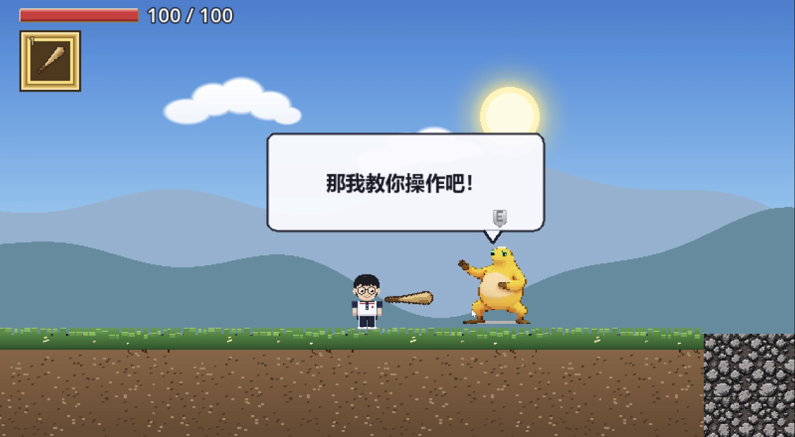
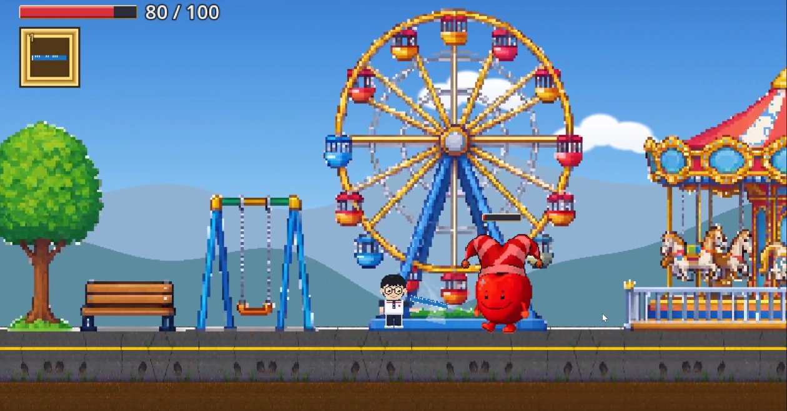
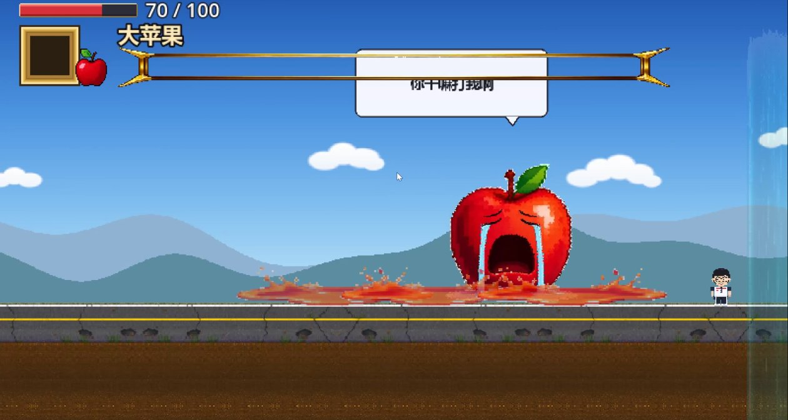
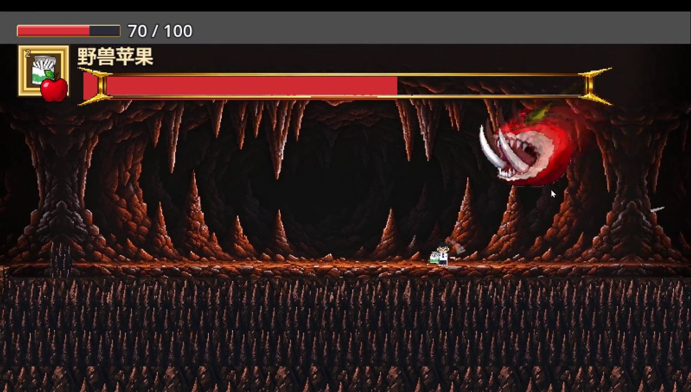
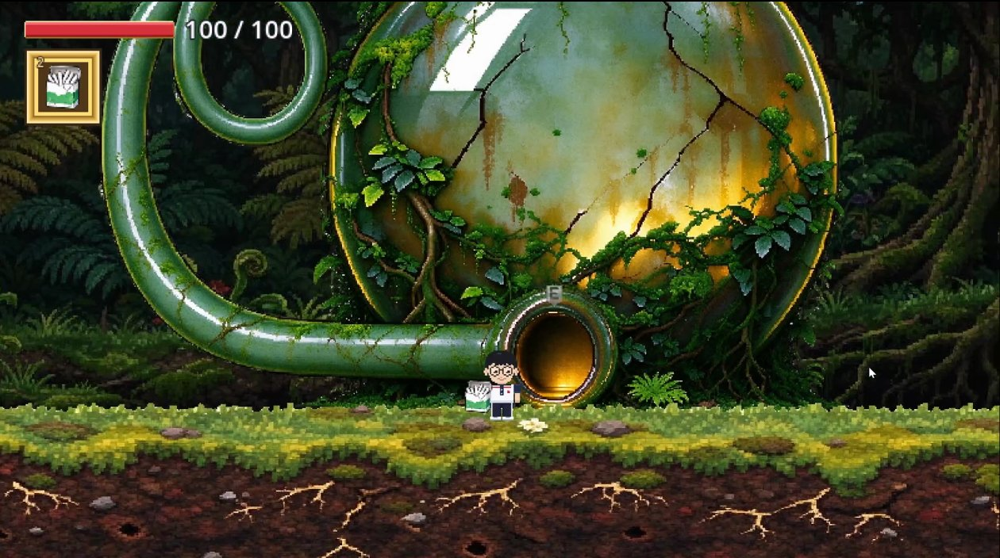
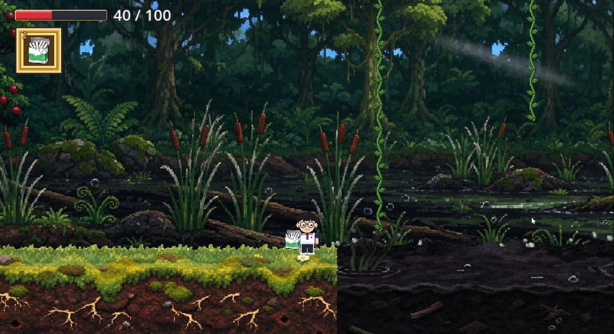
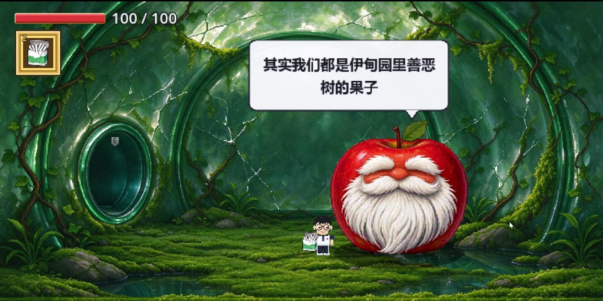

# 该死的苹果

[](https://github.com/12138hao/damned-apple/actions/workflows/test.yml)

> 大二上独立开发的横版 2D 游戏 demo

一个用 **Godot 4 + C#** 从零手写的横版动作 demo。没有用任何现成的角色控制器或战斗框架——移动、平台、战斗、敌人、Boss、对话、NPC、攀爬全部是自己一行行写出来的。

▶ **[演示视频（B 站）](https://b23.tv/L69BoxH)**（第一关通关）　·　📐 **[架构说明](docs/ARCHITECTURE.md)**　·　🍎 **[野兽苹果 Boss 架构](docs/野兽苹果Boss架构.md)**　·　👾 **[怎么做一个新怪物](docs/如何做一个新怪物.md)**

---

## 游戏截图

<table>
  <tr>
    <td width="50%"><br><sub>第一关 · 奶蛙教操作</sub></td>
    <td width="50%"><br><sub>第一关 · 主城游乐场</sub></td>
  </tr>
  <tr>
    <td width="50%"><br><sub>第一关 Boss · 大苹果被打哭</sub></td>
    <td width="50%"><br><sub>第二关 Boss · 野兽苹果</sub></td>
  </tr>
  <tr>
    <td width="50%"><br><sub>第三关 · 丛林深处的鹅颈瓶</sub></td>
    <td width="50%"><br><sub>第三关 · 泥潭与可攀爬藤蔓</sub></td>
  </tr>
  <tr>
    <td colspan="2"><p align="center"><br><sub>第三关 · 林中屋里的老苹果</sub></p></td>
  </tr>
</table>

---

## 直接下载游玩

去 **[Releases](https://github.com/12138hao/damned-apple/releases)** 下载 `damned-apple-v0.1.0-win64.zip`，解压后双击 `该死的苹果.exe`（**要整个文件夹，不能只拖出 exe**）。

> ⚠️ **v0.1.0 打包于 2026-10-27，是较早的快照**，里面只有第一关和 Boss 战。
> 第二关地下、第三关丛林、林中屋、新敌人和新 NPC 都是之后加的，还没重新打包。
> 想玩最新内容请直接跑源码，见下面「运行」。

不需要安装 Godot，也不需要装 .NET 运行时。Windows 可能弹出 SmartScreen 蓝色提示（exe 没有代码签名），点「更多信息 → 仍要运行」即可。

---

## 玩法与操作

| 按键 | 动作 |
|---|---|
| `A` / `D` | 左右移动 |
| `W` / `S` | 上瞄 / 下蹲（单向平台下穿） |
| `空格` | 跳跃（按住跳得更高） |
| `鼠标左键` | 攻击（360° 跟随鼠标方向） |
| `1` `2` `3` `4` | 切换武器槽 |
| `E` | 对话 / 存档 / 拾取 / 进出屋 |
| `R` | 上 / 下车 |
| `W`（在藤蔓旁） | 抓住藤蔓往上爬，按跳跃键蹬开 |
| `鼠标滚轮` / `鼠标左键` | 对话选项里切换 / 确认 |

### 战斗

- **空手**：连点打连击，打满连段后一拳伤害和击退翻倍
- **持武器**：按住左键蓄力，松开挥出；蓄得越久伤害和击退越高，蓄满会变成突刺
- **载具**：骑乘状态下左键水平发射子弹，移动速度提升
- **受击**：有无敌帧和击退，被击退期间不会掉头，避免「被推歪就转身」
- **判定贴着美术走**：刀的命中判定是一条「握把 → 刀尖」的线段，刀真的扫到人身上才扣血，不会出现「刀还在头顶、血却掉了」

### 探索

- **攀爬**：藤蔓是独立的可攀爬物，上爬慢、下滑会加速；两根藤之间可以直接蹬跳换藤
- **泥潭**：踩进去移动速度降到 60%，开车进去更惨（只剩 12%，基本等于陷住），跳也跳不高
- **单向平台**：站在上面按 `S` 可以下穿

### 场景与流程

```
主菜单 → 第一关 主城 ──门── 屋内
              ↓
         第二关 地下 ──门── 岩屋
              ↓
         第三关 丛林 ──门── 林中屋
```

- 门都是按 `E` 进入的传送门，可以跨场景，也可以在同一个场景里挪位置
- 存档点按 `E` 存档：记录复活点、回满血量、存档点消失
- 死亡后从存档点复活，跨场景死亡会先切回存档所在场景
- 毒区持续掉血，掉出地图会直接判定死亡

### 敌人

| 怪物 | 出没 | 行为 |
|---|---|---|
| 苹果怪 / 小怪 / 史莱姆 | 第一关 | 追踪、冲撞、碰到掉血 |
| 野兽苹果 `BeastAppleBoss` | 第二关 Boss | 双血量阶段，跳跃砸地、吐毒 |
| 恐怖苹果 `HorrorAppleEnemy` | 第二关 | 巡逻怪 |
| 海盗苹果 `PirateApple` | 第三关 | 突进 + **下砍 → 横砍**两段连招，每段 30 伤害；举起刀有前摇，砍空就一下都不掉血 |
| 骷髅苹果 `UndeadPirateApple` | 第三关 | 把骷髅手飞出去抓人，抓住后连续扣血并甩飞 |

### NPC 与对话

- **奶蛙**（第一关）：教操作，首次和再次对话是两套台词
- **老苹果**（林中屋）：首次搭话交代剧情；之后每次对话弹出**四选一菜单**，可以用鼠标滚轮切换、左键点选，也可以用 `E` 确认当前项

### Boss 战

- 踏入战场边界自动封锁出口、拉近镜头、显示 Boss 血条
- 两段血量阶段（掉到 50% 换形态，解锁吐毒），技能分跳跃砸地、吐毒
- 击败后 Boss 倒地哭泣、播完剧情，地板塌陷把玩家送出场

---

## 技术细节

| | |
|---|---|
| 引擎 | Godot 4.7.2（**.NET / C# 版本**） |
| 语言 | C#（`net8.0`） |
| 渲染 | GL Compatibility |
| 规模 | 75 个 C# 文件 / 约 13,800 行 / 19 个 `.tscn` |

几个自己写得比较得意的地方：

- **单向平台**：第 4 碰撞层专门给单向平台用，按下键时临时从碰撞遮罩里摘掉，持续时间结束后恢复，比用 `one_way_collision` 处理楼梯可靠得多
- **可攀爬物抽成基类**：`Rope` 负责「玩家在不在范围内 + 吸附 + 上下移动」，`Vine` 只覆盖「长度怎么算、上下多快、到顶抛不抛、空中抓不抓」。想让新东西能爬，继承 `Rope` 覆盖几个属性就行，攀爬逻辑一行不用改
- **判定跟着美术走**：每一帧把刀身当成线段，量玩家身体中心到这条线的距离；刀真扫到才扣血。顺手修掉了「刀在头顶却掉血」和「挥空没声音」两个毛病
- **泥潭的前景遮罩**：不另做一张前景图，而是把同一份 shader 复制第二个材质、加一个 `clip_below` 参数挂同一张贴图，颜色和动态天然像素级对齐，不会出现色阶接缝
- **音频系统**：`AudioManager` 作为 autoload 单例，8 路音效播放器轮换 + BGM 淡入淡出，音效按名字查找文件，**文件缺失时静默跳过**，所以可以先搭系统后补素材
- **对话打字机**：利用 `Label.VisibleCharacters` 逐字显示，每 N 个字触发一次音效，音高带随机抖动
- **四选一菜单**：`ChoiceMenu` 只负责「选了第几个」，播什么交给 NPC 决定；面板文字用 `Label` 子节点而不是 `DrawString`，这样才继承项目的主题字体、中文才渲染得出来
- **状态管理**：`GameState` 统一处理跨场景的血量、武器、载具、已读对话、已拾取道具、存档点
- **按模块拆分的玩家控制器**：`Box` 按移动 / 战斗 / 武器 / 抓取 / 远程 / 载具 / 蹲下 / 生命 / 视觉切成 10 个 `partial` 文件，单个文件不再动辄上千行
- **可测试的纯逻辑 + CI**：状态记录抽成不依赖 Godot 的 `GameRecords`，配套 xUnit 测试与 GitHub Actions，每次 push 自动跑
- **素材工具链**：`tools/` 下是一批纯标准库的 Python 脚本——白底泛洪抠图、按列清投影、面积平均降采样、色阶量化、可平铺藤蔓贴图生成，全部可以重跑

详细的模块划分、跨场景状态契约、动画帧段约定和逐帧更新顺序，见 **[docs/ARCHITECTURE.md](docs/ARCHITECTURE.md)**。

第二关 Boss「野兽苹果」的状态机、技能判定和踩过的坑，见 **[docs/野兽苹果Boss架构.md](docs/野兽苹果Boss架构.md)**。

想自己加一只新怪，见 **[docs/如何做一个新怪物.md](docs/如何做一个新怪物.md)**。

---

## 目录结构

```
.
├── Box.cs                 玩家控制器（模块拆分后的主文件）
├── Box.Move.cs            移动 / 跳跃 / 单向平台 / 攀爬
├── Box.Combat.cs          攻击 / 蓄力 / 连段
├── Box.Weapon.cs          武器槽与切换
├── Box.Ranged.cs          远程武器
├── Box.Grab.cs            被抓与挣脱
├── Box.Crouch.cs          蹲下与下穿
├── Box.Vehicle.cs         载具上/下车
├── Box.Life.cs            血量 / 受击 / 死亡
├── Box.Visual.cs          贴图与表现
│
├── Enemy.cs               敌人基类（受击 / 击退 / 死亡 / 巡逻 / 接触伤害）
├── AppleEnemy.cs          第一关：追踪型苹果怪
├── Enemy2.cs / Enemy3.cs  第一关：巡逻小怪
├── SlimeEnemy.cs          第一关：史莱姆
├── HorrorAppleEnemy.cs    第二关：恐怖苹果
├── PirateApple.cs         第三关：海盗苹果（两段连斩）
├── UndeadPirateApple.cs   第三关：骷髅苹果（投技）
├── BossEnemy.cs           Boss：双血量阶段 + 行为状态机 + 技能
├── BeastAppleBoss.cs      第二关 Boss：野兽苹果
├── BossArena.cs           战场：封锁、镜头、血条、战后剧情
│
├── Rope.cs                可攀爬物基类（绳 / 藤共用）
├── Vine.cs                藤蔓：长度可配、贴图平铺、上慢下滑
├── MudPit.cs              泥潭：减速、粒子、前景遮罩
├── Door.cs                传送门（跨场景 / 同场景）
│
├── Npc.cs                 普通 NPC 对话
├── OldAppleNpc.cs         老苹果：首次剧情 + 四选一
├── ChoiceMenu.cs          四选一菜单（滚轮 / 点击 / E）
├── DialogueUI.cs          气泡对话框 + 打字机
│
├── AudioManager.cs        音频单例
├── GameState.cs           跨场景状态
├── GameRecords.cs         纯 C# 状态记录（可单元测试）
├── MainMenu.cs / Hud.cs   主菜单、血条与武器槽
│
├── firstry.tscn           第一关：主城
├── house_inside.tscn      第一关：屋内
├── underground.tscn       第二关：地下
├── rockhouseinside.tscn   第二关：岩屋
├── jungle.tscn            第三关：丛林（约 8000 px 宽）
├── jungleinside.tscn      第三关：林中屋
├── tests/                 xUnit 测试工程
└── tools/                 素材生成与检查脚本（Python 纯标准库）
```

---

## 运行

1. 安装 **Godot 4.7.2 .NET 版**（普通版无法运行 C# 项目）
2. 用 Godot 打开本目录，F5 运行（主场景是 `MainMenu.tscn`）

命令行也行：

```bash
Godot_v4.7.2-stable_mono_win64.exe --path .
```

---

## 音频

仓库包含完整的音效与背景音乐，克隆下来就能直接听到声音。

音频系统是自己写的（`AudioManager.cs`）：8 路音效播放器轮换，BGM 淡入淡出，**音效按名字查找文件，找不到时静默跳过**——所以增删素材完全不用改代码。

| 目录 | 内容 |
|---|---|
| `assets/audio/sfx/` | jump / hurt / death / attack / swing / charge / pickup / blip / enemy_hurt / collapse / slam / boss_cry / vehicle_shoot / beast_* / mud_splash / mud_step / apple_swing / apple_hurt / apple_die / apple_fire / apple_grab / apple_throw |
| `assets/audio/bgm/` | town / house / boss_fight / beast_fight / horror / jungle / jungle_inside |

场景和 BGM 的对应关系写在 `AudioManager.SceneBgm` 里，一个场景一行，加新场景只要加一行映射。

对话打字音 `blip` 是用 `tools/gen_blip_soft.py` 按实测参数合成的（纯标准库，不需要任何依赖），想换音高或密度改脚本里的参数重跑即可。

---

## 素材来源与授权

| 素材 | 来源 | 说明 |
|---|---|---|
| 代码、场景、关卡 | 本项目自制 | 版权归作者 |
| 美术素材 | 本项目自制 | 版权归作者 |
| 对话打字音 `blip` | `tools/gen_blip_soft.py` 参数合成 | 本项目自制，不含任何第三方录音 |
| 音效、背景音乐 | Pixabay / GamerSounds 游戏音效工厂 | 见下方说明 |

**Pixabay** — 依据 Pixabay Content License，素材可免费使用、**无需署名**、可修改改编。该协议唯一硬性限制是不得把素材原样单独再分发。

**GamerSounds 游戏音效工厂** — 站点声明所有音效素材「完全免费」，面向独立游戏开发、Demo 制作、个人学习等场景提供。

> 以上音频素材仅作为本项目 demo 的组成部分使用，**请勿从本仓库单独提取后另作他用**。如需在自己项目中使用，请前往上述来源站点按其授权条款获取。

---

## 版权

本项目为个人学习作品，代码与美术素材版权归作者所有，**未经许可请勿商用或二次分发**。

---

*开发于 2026 年秋，大二上学期。*
