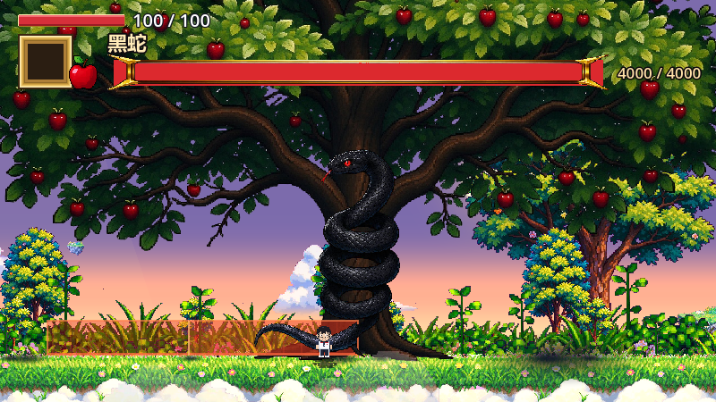
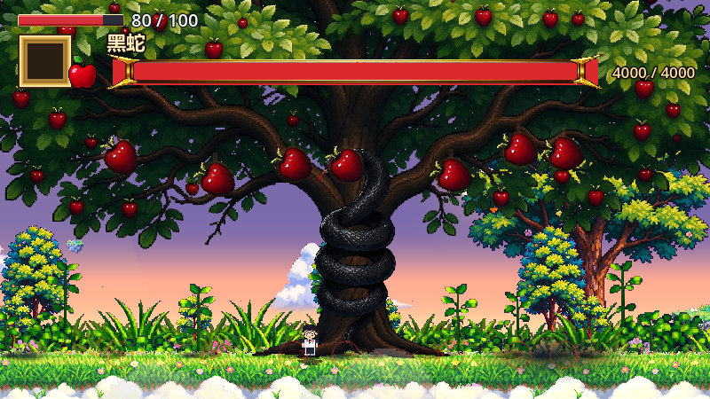
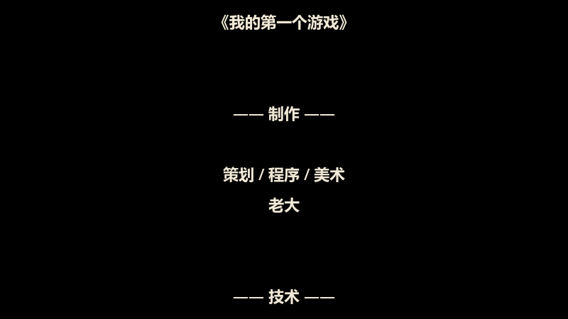

# 该死的苹果

[](https://github.com/12138hao/damned-apple/actions/workflows/test.yml)

> 大二上独立开发的横版 2D 动作游戏 · 四章流程 · 四个 Boss

一个用 **Godot 4 + C#** 从零手写的横版动作游戏。没有用任何现成的角色控制器或战斗框架——移动、平台、战斗、敌人、Boss、对话、存档、攀爬、结局演出全部是自己一行行写出来的。

▶ **[完整通关演示（B 站 · 四关）](#完整通关演示)**　·　📐 **[架构说明](docs/ARCHITECTURE.md)**　·　🍎 **[野兽苹果 Boss 架构](docs/野兽苹果Boss架构.md)**　·　👾 **[怎么做一个新怪物](docs/如何做一个新怪物.md)**

---

## 游戏截图

<table>
  <tr>
    <td width="50%"><br><sub>第一关 · 奶蛙教操作</sub></td>
    <td width="50%"><br><sub>第一关 · 主城游乐场</sub></td>
  </tr>
  <tr>
    <td width="50%"><br><sub>第一关 Boss · 大苹果被打哭</sub></td>
    <td width="50%"><br><sub>第二关 Boss · 野兽苹果</sub></td>
  </tr>
  <tr>
    <td width="50%"><br><sub>第三关 · 丛林深处的鹅颈瓶</sub></td>
    <td width="50%"><br><sub>第三关 · 泥潭与可攀爬藤蔓</sub></td>
  </tr>
  <tr>
    <td width="50%"><br><sub>第三关 · 林中屋里的老苹果</sub></td>
    <td width="50%"><br><sub>第四关 Boss · 树上的黑蛇</sub></td>
  </tr>
  <tr>
    <td width="50%"><br><sub>第四关 · 甩尾震落的三波苹果</sub></td>
    <td width="50%"><br><sub>结局 · 黑屏后滚动的制作名单</sub></td>
  </tr>
</table>

---

## 完整通关演示

四关全程实机录制（B 站，项目开源）：

| 关卡 | 内容 | 视频 |
|---|---|---|
| 第一关 | 主城 · 奶蛙教学 · 大苹果 | **[▶ 通关演示](https://b23.tv/L69BoxH)** |
| 第二关 | 地下 · 绳索攀爬 · 野兽苹果 | **[▶ 通关演示](https://b23.tv/dVpDiCM)** |
| 第三关 | 丛林 · 泥潭与攀爬藤 · 苹果仙子 | **[▶ 通关演示](https://b23.tv/GDkan9D)** |
| 第四关 | 伊甸园 · 黑蛇 · 结局演出 | **[▶ 通关演示](https://b23.tv/Zmx1szN)** |

---

## 直接下载游玩

去 **[Releases](https://github.com/12138hao/damned-apple/releases)** 下载 `damned-apple-v1.0.1-win64.zip`，解压后双击 `该死的苹果.exe`（**要整个文件夹，不能只拖出 exe**——`data_MyGame_windows_x86_64/` 是 .NET 程序集，缺了打不开）。

不需要安装 Godot，也不需要装 .NET 运行时。Windows 可能弹出 SmartScreen 蓝色提示（exe 没有代码签名），点「更多信息 → 仍要运行」即可。

> 完整流程：主城 → 地下 → 丛林 → 伊甸园，四个 Boss + 结局演出。通关约 20~30 分钟（不含重试）。
> 想自己改或看源码，见下面「运行」。

---

## 玩法与操作

| 按键 | 动作 |
|---|---|
| `A` / `D` | 左右移动 |
| `W` / `S` | 上瞄 / 下蹲（单向平台下穿） |
| `空格` | 跳跃（按住跳得更高） |
| `鼠标左键` | 攻击（360° 跟随鼠标方向） |
| `1` `2` `3` `4` | 切换武器槽 |
| `E` | 对话 / 存档 / 拾取 / 进出屋 |
| `R` | 上 / 下车 |
| `W`（在藤蔓旁） | 抓住藤蔓往上爬，按跳跃键蹬开 |
| `鼠标滚轮` / `鼠标左键` | 对话选项里切换 / 确认 |

### 战斗

- **空手**：连点打连击，打满连段后一拳伤害和击退翻倍
- **持武器**：按住左键蓄力，松开挥出；蓄得越久伤害和击退越高，蓄满会变成突刺
- **三把武器**：木棒（20~40）、尺子（30~60）走蓄力近战；粉笔（50/发）是远程投射物，打到谁就按「离粉笔最近的那个敌人」结算
- **载具**：骑乘状态下左键水平发射子弹，移动速度提升
- **受击**：有无敌帧和击退，被击退期间不会掉头，避免「被推歪就转身」
- **判定贴着美术走**：刀的命中判定是一条「握把 → 刀尖」的线段，刀真的扫到人身上才扣血；小怪的碰撞体也按每一帧的**实际画面矩形**同步，跳跃抬起来时判定跟着抬

### 探索

- **攀爬**：藤蔓是独立的可攀爬物，上爬慢、下滑会加速；两根藤之间可以直接蹬跳换藤
- **泥潭**：踩进去移动速度降到 60%，开车进去更惨（只剩 12%，基本等于陷住），跳也跳不高
- **单向平台**：站在上面按 `S` 可以下穿
- **古井转场**：从井里爬出来是一段完整的位移演出，不是硬切

### 场景与流程

```
主菜单
  └─ 第一关 主城 ──门── 屋内
        ↓
     第二关 地下 ──门── 岩屋
        ↓
     第三关 丛林 ──门── 林中屋
        ↓（击败苹果仙子后淡出）
     第四关 伊甸园 ── 黑蛇 ── 奶蛙 ── 结局字幕 ── 回主菜单
```

- 门都是按 `E` 进入的传送门，可以跨场景，也可以在同一个场景里挪位置
- 存档点按 `E` 存档：记录复活点、回满血量、存档点消失；另有「进场景自动存」的隐形存档点
- 死亡后从存档点复活，跨场景死亡会先切回存档所在场景
- 毒区持续掉血，掉出地图会直接判定死亡
- 打完 Boss 会解锁出口，死了会重置整场战斗（空气墙、镜头、血条、场上残留全部回滚）

### 敌人

| 怪物 | 出没 | 行为 |
|---|---|---|
| 苹果怪 / 小怪 / 史莱姆 | 第一关 | 追踪、冲撞、碰到掉血 |
| 大苹果 `BossEnemy` | 第一关 Boss | 双血量阶段，跳跃砸地、吐毒，被打哭后地板塌陷 |
| 野兽苹果 `BeastAppleBoss` | 第二关 Boss | 双血量阶段，冲撞、带预警的扑击、吐毒球、落地震波 |
| 恐怖苹果 `HorrorAppleEnemy` | 第二关 | 巡逻怪 |
| 海盗苹果 `PirateApple` | 第三关 | 突进 + **下砍 → 横砍**两段连招，每段 30 伤害；举起刀有前摇，砍空就一下都不掉血 |
| 骷髅苹果 `UndeadPirateApple` | 第三关 | 把骷髅手飞出去抓人，抓住后连续扣血并甩飞 |
| 苹果仙子 `AppleFairy` | 第三关 Boss | 悬浮飞行、蓄力泪光束、分裂出会同步出手的分身 |
| 黑蛇 `SnakeBoss` | 第四关 Boss | 吐毒铺池、甩尾横扫、震落苹果雨、召唤蛇小怪，半血狂暴 |
| 蛇小怪 `SnakeMinion` | 第四关 | 被召唤出来，边跳边扑；50 血，头顶有血条 |

### NPC 与对话

- **奶蛙**（第一关）：教操作，首次和再次对话是两套台词
- **老苹果**（林中屋）：首次搭话交代剧情；之后每次对话弹出**四选一菜单**，可以用鼠标滚轮切换、左键点选，也可以用 `E` 确认当前项
- **奶蛙**（伊甸园）：通关前的最后一段对话，说完就进结局

### Boss 战

四个 Boss 共用同一套战场契约（`Area2D` 战场控制器 + 独立的 Boss 本体），换地图不用改 Boss，换 Boss 不用改战场：

| Boss | 战场 | 招牌机制 |
|---|---|---|
| 大苹果 | `BossArena` | 双阶段换形态、战后地板塌陷送出场 |
| 野兽苹果 | `BeastArena` | 扑击前有地面预警带，读预警就能躲 |
| 苹果仙子 | `FairyArena` | 战斗时镜头拉远到 1200px 视野，分身同步出手 |
| 黑蛇 | `SnakeArena` | 甩尾 12 帧动画 + 整侧红色危险带 + 从树干往墙推进的蓄力条 |

- 踏入战场边界自动封锁出口、拉近镜头、显示 Boss 血条
- 血条带**当前血量数字**和**掉血残影**（红条慢一拍地退，看得出这一下掉了多少）
- 玩家死亡 → 战场立即收场：拆空气墙、还镜头、删血条、Boss 回满休眠、清空场上残留，复活后可以重新开打

### 结局与通关

打完黑蛇后走到伊甸园深处的奶蛙旁，按 `E` 对话。台词说完（中途走开不算）会：

1. 画面**缓慢黑透**，同时淡入结尾曲
2. 黑屏上从下往上滚动**制作名单与致谢**（内容在检查器里填，不用改代码）
3. 播完自动回主菜单，`ending` 那首曲子一路播到进下一关才换

黑屏之后按 `E` / `ESC` 可以跳过字幕。字幕文案、黑屏时长、滚动速度、字号行距全部是 `[Export]` 字段。

通关状态会写进存档。之后再点「继续游戏」不会把你丢回结局现场，而是弹窗提示「游戏已通关，继续游戏则开启新游戏」，确认后清档从第一关重开。

---

## 技术细节

| | |
|---|---|
| 引擎 | Godot 4.7.2（**.NET / C# 版本**） |
| 语言 | C#（`net8.0`） |
| 渲染 | GL Compatibility |
| 规模 | **102 个 C# 文件 / 约 20,700 行 / 22 个 `.tscn`**（7 张关卡地图 + 15 个预制体与 UI 场景） |
| 自动化 | xUnit 单测 + GitHub Actions；另有 111 个 Godot 无头探针脚本 |

几个自己写得比较得意的地方：

- **单向平台**：第 4 碰撞层专门给单向平台用，按下键时临时从碰撞遮罩里摘掉，持续时间结束后恢复，比用 `one_way_collision` 处理楼梯可靠得多
- **可攀爬物抽成基类**：`Rope` 负责「玩家在不在范围内 + 吸附 + 上下移动」，`Vine` 只覆盖「长度怎么算、上下多快、到顶抛不抛、空中抓不抓」。想让新东西能爬，继承 `Rope` 覆盖几个属性就行，攀爬逻辑一行不用改
- **判定跟着美术走**：每一帧把刀身当成线段，量玩家身体中心到这条线的距离；刀真扫到才扣血。小怪更细——`SnakeMinion` 预计算每一帧画面的内容矩形，换帧时同步碰撞体的尺寸和位置，跳跃抬起来时判定跟着抬，不会「看着打到、其实打空」
- **远程命中取最近**：粉笔不再用「碰到谁算谁」的物理信号，而是每帧自己做形状查询、取离粉笔最近的敌人结算。以前站在大蛇判定框前面时，粉笔会先撞上身后那条蛇，玩家看到的就是「打中了没掉血」
- **甩尾是 12 帧烘焙出来的**：只有一张尾巴贴图，用 Python 按列做竖直位移掰成 12 帧（蓄力抬尾 → 平扫 → 回收），长度和抬起角度都烘进帧里，运行时不缩放
- **泥潭的前景遮罩**：不另做一张前景图，而是把同一份 shader 复制第二个材质、加一个 `clip_below` 参数挂同一张贴图，颜色和动态天然像素级对齐，不会出现色阶接缝
- **数值外部化**：武器伤害和空手拳放在 `assets/weapons/*.tres` 与 `assets/balance/combat.tres`，**改一处全地图生效**；关卡手感（速度、跳跃、血量）仍然用 `[Export]` 按场景覆盖——这两类数值的改动频率完全不同，所以分成两套机制
- **音频系统**：`AudioManager` 作为 autoload 单例，8 路音效播放器轮换 + BGM 淡入淡出，音效按名字查找文件，**文件缺失时静默跳过**，所以可以先搭系统后补素材
- **异步技能要能被作废**：Boss 的技能是 `async void` + `await`（吐毒、召唤、苹果三波），玩家中途死亡时靠一个**战斗代次**让旧协程全部失效，否则它们醒来还会继续放招
- **状态管理**：`GameState` 统一处理跨场景的血量、武器、载具、已读对话、已拾取道具、存档点、通关标记；`SaveSystem` 把它写成 `user://save.json`
- **按模块拆分的玩家控制器**：`Box` 按移动 / 战斗 / 武器 / 抓取 / 远程 / 载具 / 蹲下 / 生命 / 视觉切成 10 个 `partial` 文件，单个文件不再动辄上千行
- **可测试的纯逻辑 + CI**：状态记录抽成不依赖 Godot 的 `GameRecords`，配套 xUnit 测试与 GitHub Actions，每次 push 自动跑
- **一套无头回归脚本**：`tools/_sd/` 下 111 个 GDScript 探针，用 `godot --headless -s` 直接驱动引擎跑验证——Boss 受击链路、死亡重置、相机归位、井口转场、伤害来源、云层边界，每一项都能一键复现并打印数字。**不打开编辑器也能证明改完没坏**
- **素材工具链**：`tools/_art/` 下是一批纯标准库的 Python 脚本——白底泛洪抠图、按列清投影、面积平均降采样、色阶量化、可平铺藤蔓贴图生成、帧序列烘焙，全部可以重跑

详细的模块划分、跨场景状态契约、动画帧段约定和逐帧更新顺序，见 **[docs/ARCHITECTURE.md](docs/ARCHITECTURE.md)**。

第二关 Boss「野兽苹果」的状态机、技能判定和踩过的坑，见 **[docs/野兽苹果Boss架构.md](docs/野兽苹果Boss架构.md)**。

想自己加一只新怪，见 **[docs/如何做一个新怪物.md](docs/如何做一个新怪物.md)**。

---

## 目录结构

```
.
├── Box.cs                 玩家控制器（模块拆分后的主文件）
├── Box.Move.cs            移动 / 跳跃 / 单向平台 / 攀爬 / 镜头
├── Box.Combat.cs          攻击 / 蓄力 / 连段
├── Box.Weapon.cs          武器槽、切换、伤害取值
├── Box.Ranged.cs          远程武器
├── Box.Grab.cs            被抓与挣脱
├── Box.Crouch.cs          蹲下与下穿
├── Box.Vehicle.cs         载具上/下车
├── Box.Life.cs            血量 / 受击 / 死亡
├── Box.Visual.cs          贴图与表现
│
├── Enemy.cs               敌人基类（受击 / 击退 / 死亡 / 巡逻 / 接触伤害）
├── AppleEnemy.cs          第一关：追踪型苹果怪
├── Enemy2.cs / Enemy3.cs  第一关：巡逻小怪
├── SlimeEnemy.cs          第一关：史莱姆
├── HorrorAppleEnemy.cs    第二关：恐怖苹果
├── PirateApple.cs         第三关：海盗苹果（两段连斩）
├── UndeadPirateApple.cs   第三关：骷髅苹果（投技）
├── BossEnemy.cs           第一关 Boss：双血量阶段 + 行为状态机
├── BeastAppleBoss.*.cs    第二关 Boss：野兽苹果（按阶段/扑击/冲撞/死亡拆文件）
├── AppleFairy.*.cs        第三关 Boss：苹果仙子（状态/技能/分身/流程）
├── SnakeBoss.*.cs         第四关 Boss：黑蛇（主逻辑/技能/死亡）
├── SnakeMinion.cs         第四关：召唤出来的蛇小怪
│
├── BossArena.cs           战场：封锁、镜头、血条、战后剧情（四个 Boss 共用一套契约）
├── BeastArena.cs          第二关战场
├── FairyArena.cs          第三关战场（战斗时镜头拉远）
├── SnakeArena.cs          第四关战场（甩尾危险带、震屏、死亡重置）
│
├── Rope.cs                可攀爬物基类（绳 / 藤共用）
├── Vine.cs                藤蔓：长度可配、贴图平铺、上慢下滑
├── MudPit.cs              泥潭：减速、粒子、前景遮罩
├── Door.cs                传送门（跨场景 / 同场景）
├── WellExit.cs            古井出场演出
│
├── Npc.cs                 普通 NPC 对话
├── OldAppleNpc.cs         老苹果：首次剧情 + 四选一
├── ChoiceMenu.cs          四选一菜单（滚轮 / 点击 / E）
├── DialogueUI.cs          气泡对话框 + 打字机
├── EndingSequence.cs      结局演出：黑屏 → 字幕滚动 → 回主菜单
│
├── AudioManager.cs        音频单例（音效池 + BGM 淡入淡出）
├── GameState.cs           跨场景状态
├── GameRecords.cs         纯 C# 状态记录（可单元测试）
├── SaveSystem.cs          存档读写（user://save.json）
├── CombatBalance.cs       全局战斗数值资源
├── MainMenu.cs / Hud.cs   主菜单、血条与武器槽
│
├── firstry.tscn           第一关：主城
├── house_inside.tscn      第一关：屋内
├── underground.tscn       第二关：地下
├── rockhouseinside.tscn   第二关：岩屋
├── jungle.tscn            第三关：丛林（约 8000 px 宽）
├── jungleinside.tscn      第三关：林中屋
├── eden.tscn              第四关：伊甸园（黑蛇 + 奶蛙 + 结局）
├── assets/weapons/        三把武器的数值资源
├── assets/balance/        全局战斗数值
├── tests/                 xUnit 测试工程
├── tools/_art/            素材生成脚本（Python 纯标准库）
└── tools/_sd/             无头回归探针（GDScript）
```

---

## 运行

1. 安装 **Godot 4.7.2 .NET 版**（普通版无法运行 C# 项目）
2. 用 Godot 打开本目录，F5 运行（主场景是 `MainMenu.tscn`）

命令行也行：

```bash
Godot_v4.7.2-stable_mono_win64.exe --path .
```

跑单元测试（不用开游戏）：

```bash
run-tests.cmd          # Windows
dotnet test tests/
```

跑无头回归探针（示例：验证某张场景能不能正常加载）：

```bash
Godot_v4.7.2-stable_mono_win64_console.exe --headless --path . res://jungle.tscn --quit-after 120
```

---

## 音频

仓库包含完整的音效与背景音乐，克隆下来就能直接听到声音。

音频系统是自己写的（`AudioManager.cs`）：8 路音效播放器轮换，BGM 淡入淡出，**音效按名字查找文件，找不到时静默跳过**——所以增删素材完全不用改代码。

| 目录 | 内容 |
|---|---|
| `assets/audio/sfx/` | 36 个：jump / hurt / death / attack / swing / charge / pickup / blip / enemy_hurt / collapse / slam / boss_cry / vehicle_shoot / beast_*（8）/ mud_splash / mud_step / apple_*（6）/ snake_*（6）/ tree_shake |
| `assets/audio/bgm/` | 11 首：town / house / boss_fight / beast_fight / fairy_fight / horror / jungle / jungle_inside / eden / snake_fight / ending |

场景和 BGM 的对应关系写在 `AudioManager.SceneBgm` 里，一个场景一行，加新场景只要加一行映射。

Boss 音效全部提到检查器里了（黑蛇一个节点上有 9 个音效名字段，另加继承来的受击 / 死亡），想换音效只改字段、不碰代码。

对话打字音 `blip` 是用 `tools/gen_blip_soft.py` 按实测参数合成的（纯标准库，不需要任何依赖），想换音高或密度改脚本里的参数重跑即可。

---

## 素材来源与授权

| 素材 | 来源 | 说明 |
|---|---|---|
| 代码、场景、关卡、数值 | 本项目自制 | 版权归作者 |
| 美术素材 | **AI 图像模型生成 + 本项目后处理** | 底图由文生图模型生成，抠透明底、切分帧段、调色、拼合由 `tools/_art/` 的脚本完成 |
| 对话打字音 `blip` | `tools/gen_blip_soft.py` 参数合成 | 本项目自制，不含任何第三方录音 |
| 音效、背景音乐 | Pixabay / GamerSounds 游戏音效工厂 | 见下方说明 |

**Pixabay** — 依据 Pixabay Content License，素材可免费使用、**无需署名**、可修改改编。该协议唯一硬性限制是不得把素材原样单独再分发。

**GamerSounds 游戏音效工厂** — 站点声明所有音效素材「完全免费」，面向独立游戏开发、Demo 制作、个人学习等场景提供。

> 以上音频素材仅作为本项目 demo 的组成部分使用，**请勿从本仓库单独提取后另作他用**。如需在自己项目中使用，请前往上述来源站点按其授权条款获取。

---

## 版权

本项目为个人学习作品，代码与美术素材版权归作者所有，**未经许可请勿商用或二次分发**。

---

*开发于 2026 年秋，大二上学期。*
